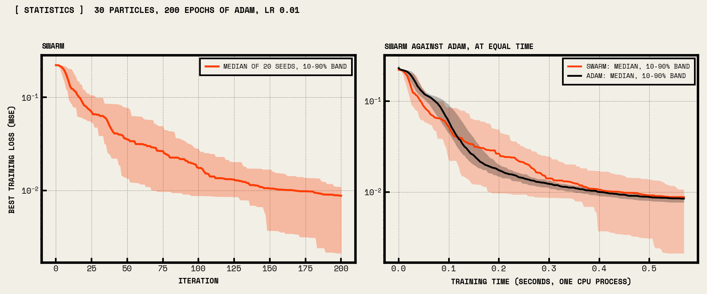
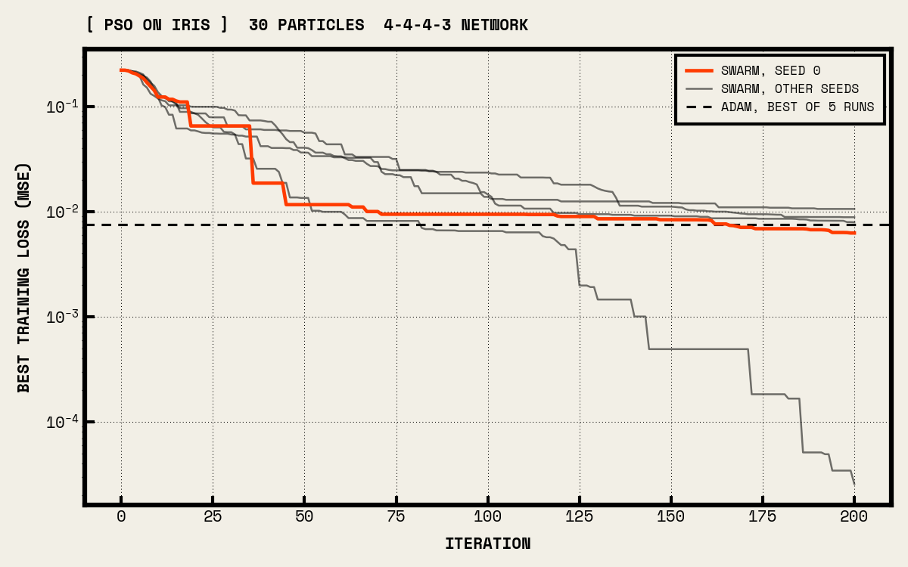
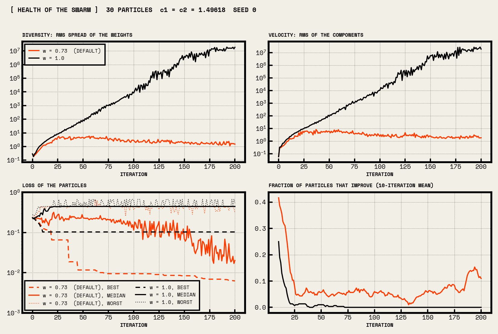
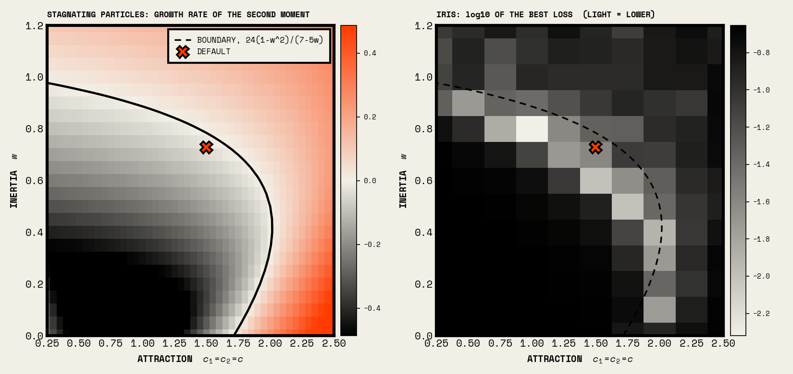
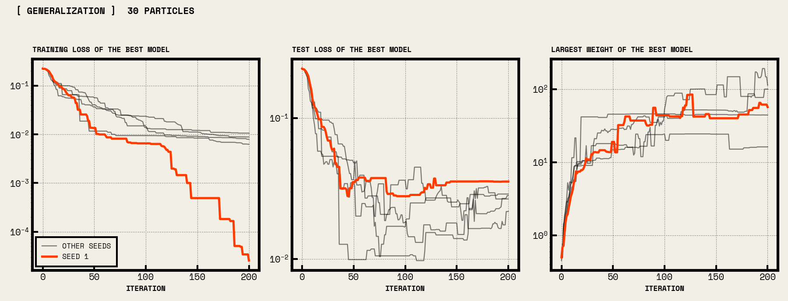

# pso

Particle swarm optimization (PSO) of the weights of a small PyTorch network, as an alternative to backpropagation. No gradients are used: the swarm only needs the value of the loss.

The algorithm follows the original paper and the later analyses of its parameters. The design choices are listed below.

## The algorithm

A particle is one complete set of weights, a point `theta` in `R^D`. Every particle remembers the best position `p` it has visited, and the swarm remembers the best position `g` of all the particles. One iteration is

```
v     <- w v + c1 r1 (p - theta) + c2 r2 (g - theta)
theta <- theta + v
```

where `r1` and `r2` are vectors of `D` independent uniform random numbers in `[0, 1]`, drawn anew for every particle and every iteration (the products are element-wise). The loss of a particle is the loss of the network with its weights on the training set, and the best positions are updated after all the particles have moved.

The original paper has `w = 1` and `c1 = c2 = 2`. The inertia weight `w` comes from Shi and Eberhart, and the defaults `w = 0.7298`, `c1 = c2 = 1.49618` are the constriction coefficient of Clerc and Kennedy, which is also the choice of the standard PSO of Bratton and Kennedy.

## Usage

```python
from pso import Swarm

swarm = Swarm(model, loss_fn, n_particles=30, seed=0)   # model: any torch.nn.Module, loss_fn(output, target)
swarm.fit(x_train, y_train, iterations=200, verbose=20)
best = swarm.best_model()                               # a copy of the model with the best weights
```

`python example.py` trains a small network (4 -> 4 -> 4 -> 3, sigmoid, sigmoid, softmax, mean squared error) on the Iris data set, and compares the swarm with the best of a few runs of Adam. Requirements: `torch`, `scikit-learn`, and `matplotlib` for the figure. `python test_pso.py` runs the checks (the update rule against a direct computation, one random number per weight, seed, a convex problem) and `python plots.py` makes all the figures (about 5 minutes).

## Results

The Iris example: 75 samples for training and 75 for testing (stratified split), 30 particles and 200 iterations of the swarm, against Adam (learning rate 0.01, 200 epochs, batches of 8). Both are run for 20 seeds. The hyperparameters of Adam are my choice, and I did not tune either method. Median and 10-90% range over the seeds:

| | train loss | train accuracy | test loss | test accuracy |
|---|---|---|---|---|
| swarm | 0.0088 [0.0021, 0.0107] | 0.987 [0.987, 1.000] | 0.0261 [0.0126, 0.0367] | 0.947 [0.944, 0.975] |
| Adam | 0.0087 [0.0077, 0.0102] | 0.987 [0.985, 0.987] | 0.0179 [0.0159, 0.0220] | 0.960 [0.959, 0.960] |

One test sample is 0.013 of accuracy. The median training losses are the same, the swarm has a much wider spread (its best seeds go far below Adam, its worst do not reach it), and its test loss is worse. In the figure the two methods are compared at equal training time: a run takes about 0.5 s for both, on one CPU process. The network has 55 weights, so these times are dominated by the overhead of Python, and they say nothing about larger networks. Within its run 14 of the 20 swarms reach a training loss of 0.01, against 20 of 20 for Adam (median time 0.4 s).



For a few seeds, the best training loss of the swarm and the one of Adam:



## Diagnostics

`Swarm.stats` records, at the start and after every iteration, the diversity of the particles (rms spread of the weights around their centroid), the rms velocity, the minimum, median and maximum current loss, the fraction of particles that improve, and the largest weight of the best position. `fit` also takes a `callback(swarm)`, called after every iteration.

**Health of the swarm** (`python plots.py health`). The default `w = 0.73` is compared with `w = 1`, with the same `c1 = c2`.



With `w = 1` the diversity and the velocity grow exponentially, from about 0.1 to about 10^7 in 200 iterations, the best loss stops at about 0.1, and after iteration 75 no particle improves. With the default the diversity grows to about 5 in the first 40 iterations and then decays slowly, to about 1.5 at the end: the swarm has not contracted yet in 200 iterations, and 5-15% of the particles still improve at every step. So it has not converged prematurely, and it is also not finished.

**Stability map** (`python plots.py map`). For a particle that stagnates (`p = g = 0`) in one dimension, the update is linear in `(x, v)` with random coefficients, and the second moments obey an exact linear recursion. The left panel is its growth rate over the plane `(c, w)` with `c1 = c2 = c`. The contour of zero agrees with the boundary `c1 + c2 < 24 (1 - w^2) / (7 - 5 w)` of Poli [5]: I solved the recursion for the boundary at `w = 0, 0.3, 0.5, 0.7298, 0.9` and got `c = 1.7143, 1.9855, 2.0000, 1.6737, 0.9120`, the same numbers as the formula to the digits shown. The default is inside the stable region, with `c = 1.496` against the boundary at `1.674`. The right panel is the best loss on Iris (100 iterations, 15 particles, 2 seeds per cell).



The loss is high on both sides: outside the boundary the swarm spreads, deep inside it contracts too early. The cells with the lowest loss form a band just inside the boundary. The default is in that band's neighbourhood, but a few cells are better, for example `(c, w) = (1.0, 0.8)`. With two seeds and a coarse grid I would not read the individual cells.

**Generalization** (`python plots.py generalization`). The training loss, the test loss and the largest weight of the best model at every iteration, 5 seeds.



| seed | final train loss | final test loss | lowest test loss (iteration) | largest weight at the end |
|---|---|---|---|---|
| 0 | 0.0063 | 0.0282 | 0.0097 (111) | 44 |
| 1 | 0.00003 | 0.0354 | 0.0279 (92) | 57 |
| 2 | 0.0079 | 0.0217 | 0.0131 (110) | 113 |
| 3 | 0.0088 | 0.0266 | 0.0187 (80) | 100 |
| 4 | 0.0106 | 0.0289 | 0.0104 (75) | 16 |

The training loss keeps decreasing, but in all five seeds the test loss has its minimum between iterations 75 and 111 and ends 1.3 to 2.9 times higher, while the largest weight grows to between 16 and 113. The swarm has nothing that keeps the weights small. The lowest test loss is chosen on the test set, so it is optimistic: a stopping rule would need a validation set taken out of the training data. With five seeds I cannot say whether the size of the weights explains the differences between them.

## Design choices

These are the choices that matter, with the reason for each.

1. **One random number per weight.** In the paper the random factor is element-wise: the velocity is a matrix of agents by dimensions, and `rand()` is drawn for each entry. With a single scalar for all the weights a particle could only move along the straight lines towards `p` and `g`, and the search would lose most of its diversity. Here `r1` and `r2` have the shape of the positions. Measured with `python ablation.py` (switch `per_weight`, 20 seeds, everything else equal): the median best training loss is 0.0088 with one number per weight and 0.0728 with one per particle, the test accuracy 0.947 against 0.800, and the spread of the swarm at the end 2.70 against 0.11.
2. **The loss is always computed on the same data.** PSO needs a fixed function to minimize: the loss of a particle now, its best loss and the best loss of the swarm must refer to the same function. If every particle were scored on a different mini-batch, a "best" score would be partly a lucky batch. So the loss is computed on the whole training set, which is cheap for a small network.
3. **Parameters.** The usual analysis of the stability of the swarm needs `|w| < 1`, so with `w = 1` (as in the original paper) the oscillation of a particle around its attractors does not decay: see the diagnostics below, where the spread of the swarm grows exponentially. The defaults are `w = 0.7298`, `c1 = c2 = 1.49618`.
4. **Swarm size.** The default is 30 particles. With very few particles the global best is just the better of a few points. An iteration is one move of the whole swarm.
5. **Reproducibility.** A `seed` fixes the initial weights, the velocities and every random number of the swarm, and the global random state of PyTorch is not touched by the swarm.
6. **Initial positions.** The first particle is the model that is given, and the others are new random initializations of the same network. The velocities start uniform in `[-0.1, 0.1]`.
7. **Synchronous update.** All the particles move with the same `p` and `g`, and then the best positions are updated. Updating `g` after every particle is a legitimate variant too, but it makes the result depend on the order of the particles.

## References

1. J. Kennedy, R. Eberhart. *Particle swarm optimization.* Proceedings of the IEEE International Conference on Neural Networks, vol. 4, pp. 1942-1948, 1995. doi:10.1109/ICNN.1995.488968. The paper already trains the weights of a network (XOR, and the Iris data set).
2. Y. Shi, R. Eberhart. *A modified particle swarm optimizer.* Proceedings of the IEEE International Conference on Evolutionary Computation, pp. 69-73, 1998. doi:10.1109/ICEC.1998.699146. The inertia weight.
3. M. Clerc, J. Kennedy. *The particle swarm: explosion, stability, and convergence in a multidimensional complex space.* IEEE Transactions on Evolutionary Computation 6(1):58-73, 2002. The constriction coefficient.
4. D. Bratton, J. Kennedy. *Defining a standard for particle swarm optimization.* IEEE Swarm Intelligence Symposium, pp. 120-127, 2007. doi:10.1109/SIS.2007.368035.
5. R. Poli, J. Kennedy, T. Blackwell. *Particle swarm optimization: an overview.* Swarm Intelligence 1:33-57, 2007. doi:10.1007/s11721-007-0002-0. A review, with the analysis of the stability.
